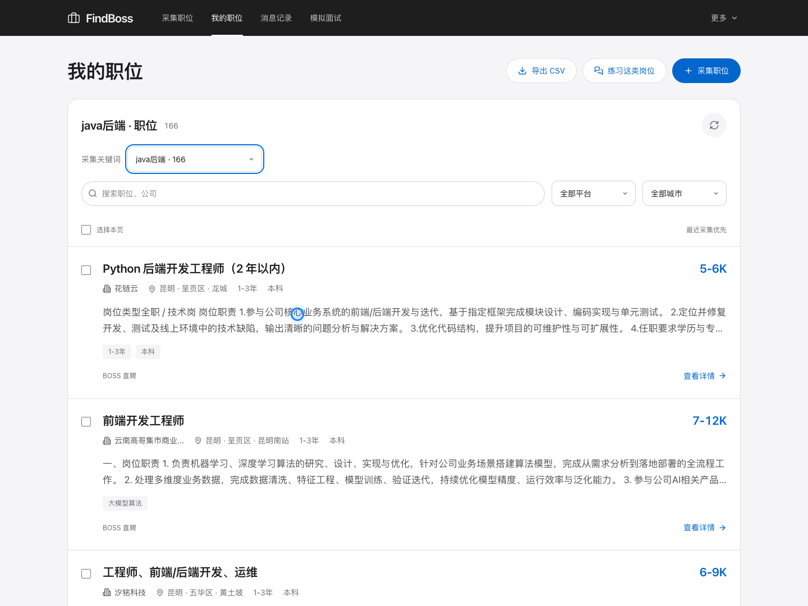
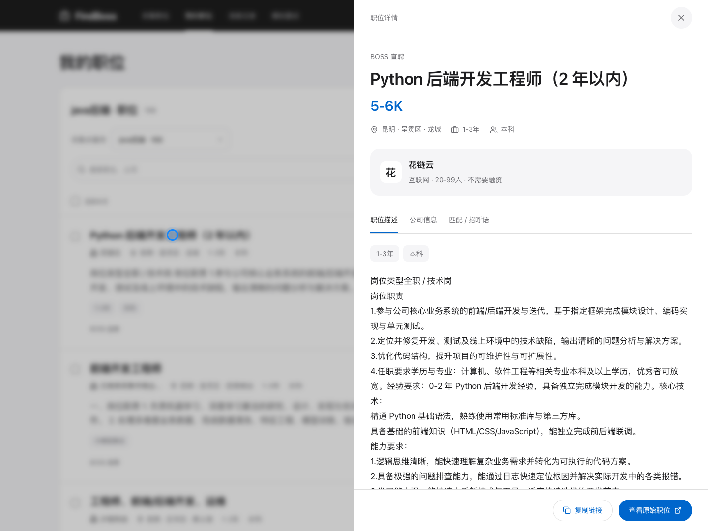

<div align="center">


# LookForBoss v1.0.0

**FindBoss · 本地求职工作台**

---

### 把找工作、投递沟通和面试练习，放进一个工作台。

<p>
  
  
  
  
  
  <a href="https://github.com/manongshi/LookForBoss/stargazers"></a>
</p>

**前端已内置 · 启动后端即可访问 · SQLite 自动初始化**

无需安装 MySQL，无需单独启动前端开发服务。

[快速开始](#快速开始) · [功能介绍](#功能介绍) · [系统截图](#系统截图) · [开发说明](#开发说明) · [问题反馈](https://github.com/manongshi/LookForBoss/issues)

</div>

<p align="center">
  
</p>

## 项目介绍

LookForBoss 是一个运行在本机的求职工具，界面名称为 **FindBoss**。从招聘平台采集职位，在本地筛选和整理岗位，结合求职资料分析匹配条件，再把真实岗位要求带入 AI 模拟面试。

前端由 Vue 3 构建，打包资源随项目保存在 `backend/static`；FastAPI 同时提供页面和接口。SQLite 数据文件、任务记录及浏览器资料在本机持久保存。

## 功能介绍

| 功能 | 说明 |
| --- | --- |
| 多平台职位采集 | 按关键词、城市及平台筛选条件采集职位，查看进度与实时日志 |
| 职位管理 | 搜索职位与公司，按关键词、来源平台和城市筛选，查看详情并导出 CSV |
| 求职助手 | 管理个人技能、目标岗位、意向城市、工作年限与薪资底线 |
| 岗位匹配 | 对照求职资料展示岗位要求、匹配依据和待确认条件 |
| 投递与沟通 | 发起简历投递、打招呼和消息发送任务，记录任务状态与执行结果 |
| 黑名单 | 按公司、职位关键词或招聘者配置拦截规则 |
| AI 打招呼语 | 结合职位要求和个人经历生成招呼语，支持预览与编辑 |
| AI 模拟面试 | 从同类职位、具体职位或手动填写的要求出题，支持回答、追问和继续练习 |
| 面试反馈 | 保存面试对话，生成反馈、能力维度评分与改进建议 |
| 数字人及语音 | 可选的数字人面试官、语音输入与语音播放，需要额外准备运行环境和模型 |
| 职位分布 | 查看薪资、地区与经验要求等统计信息 |
| 本地存储 | 自动创建 SQLite 文件和数据表，重启后保留已保存的数据 |

### 招聘平台

| 平台 | 当前状态 |
| --- | --- |
| BOSS 直聘 | 已接入 |
| 猎聘 | 已接入 |
| 前程无忧 | 实验性接入 |
| 智联招聘 | 实验性接入 |

采集使用本机专用 Chrome。首次使用时，在工作台打开对应平台并手动登录；平台登录状态分别保存在本地。实际可用性受平台页面变化及账号状态影响。

## 快速开始

### 运行条件

- Python **3.10 或以上版本**，并具备 `pip` 和 `venv`。
- 使用职位采集和投递功能时，需要本机安装 Google Chrome。
- 首次安装依赖需要网络连接；基础功能无需配置数据库或 AI 密钥。

### macOS / Linux

```bash
git clone https://github.com/manongshi/LookForBoss.git
cd LookForBoss
bash run-backend.sh
```

启动脚本会自动创建或复用 `.venv` 虚拟环境，安装 `backend/requirements.txt` 中的依赖，然后启动后端。服务启动时会自动初始化 SQLite。

浏览器打开 **http://127.0.0.1:8000** 即可使用，按 `Ctrl+C` 停止服务。

如果默认端口被占用：

```bash
bash run-backend.sh --port 8001
```

随后访问 `http://127.0.0.1:8001`。

### Windows

在项目根目录使用 PowerShell 执行：

```powershell
py -3 -m venv .venv
.\.venv\Scripts\python.exe -m pip install -r backend\requirements.txt
.\.venv\Scripts\python.exe backend\run.py
```

服务启动后，同样访问 **http://127.0.0.1:8000**。本仓库内置了前端构建产物，日常运行无需 Node.js。

### 开始使用

1. 在「采集职位」选择平台、关键词和城市，打开采集浏览器并登录。
2. 开始采集，在「我的职位」筛选、查看或导出已保存的岗位。
3. 在「更多 → 求职助手」填写个人资料，查看岗位匹配依据并设置黑名单。
4. 需要投递或沟通时，选择职位并发起对应任务，在「消息记录」和「任务记录」查看结果。
5. 进入「模拟面试」，配置模型，选择岗位要求后开始练习并查看反馈。

## 系统截图

以下为项目实际运行页面截图。展示中的职位、面试记录和模型配置不会随源码附带，首次启动会创建自己的本地数据。

### 职位详情

查看岗位信息、招聘要求与来源链接，衔接匹配分析、投递和面试准备。



### 面试准备

从真实职位读取要求，选择难度、题目数量、模型和面试官。


### 面试对话

逐题作答，围绕回答继续追问，并保留完整练习记录。


### 反馈报告

查看本轮表现、各能力维度的反馈和下一次练习的改进方向。


## AI 与数字人配置

### 文字面试

在「模拟面试 → 面试模型」中选择提供方，填写对应模型名称和 API Key。当前支持 **MiniMax、DeepSeek 和通义千问（百炼）**。调用模型时，相关岗位要求和回答会发送给所选提供方。

### AI 打招呼语

此功能使用 MiniMax，可选地复制配置示例：

```bash
cp backend/.env.example backend/.env
```

在本地 `backend/.env` 中填写：

```dotenv
MINIMAX_API_KEY=your_api_key_here
MINIMAX_MODEL=MiniMax-M3
```

修改环境配置后重启后端。真实密钥及个人配置不应提交到仓库。

### 数字人与语音（可选）

`backend/ai-mock-interview` 保留了独立的媒体运行时代码。数字人口型、语音识别等功能需要另建 Python 环境、安装该目录内的依赖，并准备相应模型权重和人物素材；这些较大的运行资源不包含在本仓库中。

后端默认查找该目录的 `.venv`，也可在 `backend/.env` 中设置 `INTERVIEW_RUNTIME_DIR` 与 `INTERVIEW_PYTHON` 指向已准备好的环境。运行环境就绪后，在页面点击「连接数字人」由后端启动对应服务。文字面试可以独立使用。

## 数据保存

| 内容 | 默认位置 |
| --- | --- |
| 职位、任务、沟通和求职资料 | `runtime/findboss.sqlite3` |
| 招聘平台登录状态 | `runtime/browser-profile/` |
| 面试设置、会话和运行日志 | `runtime/interviews/` |
| 可选环境配置 | `backend/.env` |

默认路径相对于项目根目录。`DATABASE_FILE` 可以调整数据库文件名，环境变量 `FINDBOSS_DATA_DIR` 可以指定数据根目录。无需手动建库、导入 SQL 或配置数据库账号。

备份数据时，先停止服务，再备份整个 `runtime` 目录；恢复时在服务停止的状态下还原该目录。

## 开发说明

### 项目结构

```text
LookForBoss/
├── backend/
│   ├── app/                  # FastAPI 接口、SQLite、采集与任务管理
│   ├── static/               # 已打包的前端，可直接随后端运行
│   ├── ai-mock-interview/    # 可选数字人与语音运行时代码
│   ├── run.py                # 后端启动入口
│   └── requirements.txt      # 基础运行依赖
├── frontend/
│   ├── src/                  # Vue 3 前端源码
│   ├── public/               # 前端静态素材
│   └── vite.config.js        # 构建产物输出到 backend/static
├── docs/                     # 项目图标和实际页面截图
├── run-backend.sh            # 创建环境、安装依赖并启动服务
├── run-frontend.sh           # 前端开发服务
├── setup.sh                  # 可选的依赖初始化脚本
└── README.md
```

### 修改前端

日常使用直接运行后端即可。需要修改前端源码时，再安装 Node.js 和 npm：

```bash
cd frontend
npm ci
npm run dev
```

前端开发地址为 `http://127.0.0.1:5173`，`/api` 请求代理至 `http://127.0.0.1:8000`，开发时同时运行后端。

修改完成后更新内置页面：

```bash
cd frontend
npm run build
```

构建结果会直接写入 `backend/static`，后端的页面路由支持直接访问及刷新。生产页面通过同源 `/api` 调用接口。

后端的浏览器和运行任务由单个进程持有，请使用默认的单 worker 启动方式。

## 致谢

- [Vue](https://github.com/vuejs/core)、[Element Plus](https://github.com/element-plus/element-plus)、[Lucide](https://github.com/lucide-icons/lucide)：前端界面与图标。
- [FastAPI](https://github.com/fastapi/fastapi)、[Uvicorn](https://github.com/encode/uvicorn)：后端服务。
- [get_jobs](https://github.com/loks666/get_jobs)：招聘平台筛选字典参考。
- [Linly-Talker-Stream](https://github.com/Kedreamix/Linly-Talker-Stream)、[LiveTalking](https://github.com/lipku/LiveTalking)：可选媒体运行时的上游项目。

媒体运行时保留了原有 [LICENSE](backend/ai-mock-interview/LICENSE) 和 [NOTICE](backend/ai-mock-interview/NOTICE)，相关第三方代码与模型遵循各自许可。

<div align="center">

**如果这个项目对你有帮助，欢迎点一个 Star。**

[提交问题与建议](https://github.com/manongshi/LookForBoss/issues)

</div>
